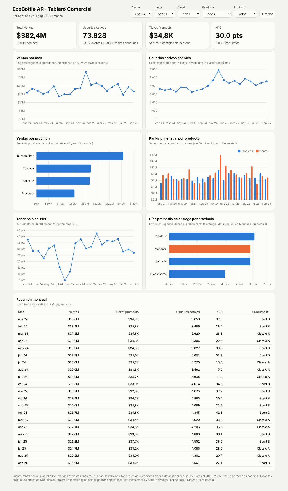
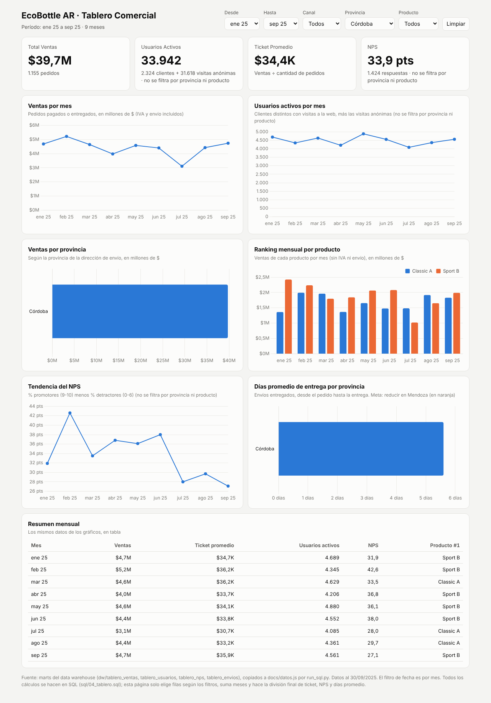

# EcoBottle AR: data warehouse y tablero comercial

Trabajo práctico de **Introducción al Marketing Online y los Negocios Digitales**.

Se armó un modelo estrella (metodología Kimball) a partir de los datos de ventas online y offline de EcoBottle AR, y un tablero para el área comercial con los KPIs: **Ventas, Usuarios Activos, Ticket Promedio, NPS, Ventas por Provincia y Ranking Mensual por Producto**.

- Datos de origen: carpeta `raw/` (una foto del sistema al 30/09/2025, pedidos del 01/01/2024 al 30/09/2025, montos en pesos argentinos).
- Data warehouse: carpeta `dw/` (un CSV por tabla, generados por `run_sql.py`).
- **Tablero interactivo:** https://benjabalsola.github.io/practica-imond/

## Cómo ejecutarlo

Requisitos: Python 3.9 o más nuevo y Git.

```bash
git clone https://github.com/benjabalsola/practica-imond.git
cd practica-imond
python3 -m venv .venv
source .venv/bin/activate        # Windows: .venv\Scripts\activate
pip install -r requirements.txt
python run_sql.py                # arma todo desde cero
```

Ese único comando:

1. Borra `warehouse.duckdb` y `dw/` y los vuelve a crear desde los CSV de `raw/`.
2. Ejecuta los archivos de `sql/` en orden. Si falla algún control de `05_validaciones.sql`, se detiene con un error.
3. Exporta cada tabla a `dw/<tabla>.csv` y dibuja el modelo en `dw/modelo_estrella.md`.
4. Copia los marts del tablero (`dw/tablero_*.csv`) a `docs/datos.js`, que es el archivo que lee el tablero.

Correrlo dos veces da exactamente los mismos archivos. Para ver el tablero en local, abrí `docs/index.html` en el navegador. Opcional: `python run_sql.py --ui` abre DuckDB en el navegador para explorar las tablas.

### Archivos SQL (se ejecutan en este orden)

| Archivo | Qué hace |
|---|---|
| `sql/01_dimensiones.sql` | Crea y carga las 15 dimensiones, cada una con su fila `-1` "Desconocido" |
| `sql/02_hechos.sql` | Crea y carga los 6 hechos, con `PRIMARY KEY` y `FOREIGN KEY ... NOT NULL` declaradas en el `CREATE TABLE` |
| `sql/03_consultas.sql` | Consultas clave de los 6 KPIs |
| `sql/04_tablero.sql` | Marts del tablero (`tablero_*`), ya agregados por mes |
| `sql/05_validaciones.sql` | 42 controles: filas raw contra DW, sumas que cierran, FK huérfanas y marts contra hechos |

## Arquitectura

```
raw/*.csv ──► sql/01, 02 ──► dim_* y fact_* ──► sql/04 ──► tablero_* ──► dw/*.csv ──► docs/datos.js ──► docs/index.html
            (modelo estrella)                  (marts)               (run_sql.py)    (copia sin cálculos)   (solo muestra)
```

- Los marts leen solo tablas `fact_` y `dim_`, nunca `raw`.
- Todos los cálculos se hacen en SQL: JOINs, conteos distintos (pedidos, usuarios), reparto por producto y ranking.
- El tablero solo elige las filas que coinciden con los filtros, suma meses y hace la división final de los cocientes (ticket, NPS, días promedio). No hace JOINs ni conteos distintos.
- Para no sumar conteos distintos entre canales, provincias o productos, los marts traen filas `Todos` (`GROUP BY CUBE`). El tablero toma siempre la fila exacta del filtro elegido.

## Modelo estrella

El diagrama completo, con claves y relaciones, está en [`dw/modelo_estrella.md`](dw/modelo_estrella.md). El diagrama del sistema de origen (provisto por la cátedra) está en [`assets/DER.png`](assets/DER.png):


- **Dimensiones de negocio:** `dim_date`, `dim_channel`, `dim_province`, `dim_product`, `dim_store`, `dim_customer`, `dim_address`.
- **Dimensiones de atributos:** `dim_order_status`, `dim_payment_method`, `dim_payment_status`, `dim_shipment_status`, `dim_carrier`, `dim_web_source`, `dim_device`, `dim_nps_score`.
- **Hechos:** `fact_order`, `fact_sales`, `fact_payment`, `fact_shipment`, `fact_web_session`, `fact_nps`.

## Supuestos

1. **Venta** = pedido con estado `PAID` o `FULFILLED` (`dim_order_status.es_venta`). `CREATED`, `CANCELLED` y `REFUNDED` no cuentan.
2. **Total Ventas** usa `total_amount` (subtotal + IVA 21 % + envío), como pide la consigna. **Ticket Promedio** = `SUM(total_amount) / COUNT(*)` con el mismo filtro.
3. **Provincia de una venta** = provincia de la dirección de envío. En las compras en tienda la dirección de envío es la de la tienda (se comprobó: coinciden en los 4.683 pedidos OFFLINE).
4. **Fechas:** venta, pago y envío usan la fecha del pedido (`order_date`); el pago también guarda la fecha de cobro (`paid_at`) y el envío las de despacho y entrega. Las sesiones usan `started_at` y el NPS `responded_at`.
5. **Usuarios activos** = clientes distintos con al menos una visita web en el período **más** las visitas anónimas, contadas por `session_id` distinto (como dice la consigna). Una persona anónima con varias visitas cuenta varias veces, porque no se puede saber si es la misma.
6. **Usuarios activos** se calcula para cada período completo (mes desde, mes hasta), porque los usuarios distintos de varios meses no son la suma de cada mes.
7. **NPS** = (% de promotores 9-10 − % de detractores 0-6) × 100. Las respuestas anónimas sí se cuentan.
8. **Reparto por producto:** cuando se filtra por producto, el `total_amount` de cada pedido se reparte entre sus productos en proporción a `line_total / subtotal` (así el IVA y el envío se reparten igual). La suma de todos los productos da exactamente el total. En ese caso el Ticket Promedio es ventas repartidas ÷ pedidos que incluyen el producto.
9. **Días de entrega** = `date_diff('day', order_date, delivered_at)`: cuenta cambios de fecha calendario, no horas ÷ 24. El promedio incluye solo envíos `DELIVERED` y se calcula como suma de días ÷ cantidad de entregas.
10. **Ranking mensual por producto** usa `SUM(line_total)` (sin IVA ni envío) y `RANK()`, así que los empates comparten puesto. En el tablero, el ranking se calcula para cada mes, canal y provincia.
11. Cuando un dato no existe (cliente anónimo, pedido online sin tienda, pedido sin dirección de facturación, pago no cobrado, envío no entregado), la clave apunta a la fila **-1 "Desconocido"** de su dimensión. Ninguna clave de un hecho es NULL.
12. `fact_payment` y `fact_shipment` copian canal, cliente y provincia del pedido.
13. Los IDs del sistema de origen se guardan como `BIGINT`, porque superan el rango de `INTEGER`. Las claves de fecha tienen formato `AAAAMMDD` (ej. `20240131`).
14. La consigna menciona scripts en Python. Las transformaciones están escritas en SQL y las ejecuta el script de Python `run_sql.py`.

## Diccionario de datos

`_key` es la clave subrogada del data warehouse y `_id` es la clave natural del sistema de origen. **Todas las dimensiones tienen la fila `-1` "Desconocido"** (en `dim_date`, `date_key = -1` con `fecha` vacía).

### Dimensiones

| Tabla | Grano | Columnas y dominios |
|---|---|---|
| `dim_date` | un día (01/01/2024 a 30/09/2025) | `date_key` PK (AAAAMMDD), `fecha`, `anio`, `trimestre`, `mes`, `nombre_mes`, `dia`, `nombre_dia`, `es_fin_de_semana` |
| `dim_channel` | un canal de venta | `channel_key` PK, `channel_id`, `code` (`ONLINE` / `OFFLINE`), `name` |
| `dim_province` | una provincia | `province_key` PK, `province_id`, `name`, `code` |
| `dim_product` | un producto | `product_key` PK, `product_id`, `sku`, `name`, `category` (Classic / Sport), `family` (Bottles), `list_price` |
| `dim_store` | una tienda física | `store_key` PK, `store_id`, `name`, `city`, `province` (la fila -1 se llama "Sin tienda") |
| `dim_customer` | un cliente | `customer_key` PK, `customer_id`, `full_name`, `email`, `status` (`A` activo / `I` baja), `created_at` |
| `dim_address` | una dirección | `address_key` PK, `address_id`, `city`, `postal_code`, `province`, `country_code` (`AR`) |
| `dim_order_status` | un estado de pedido | `order_status_key` PK, `code` (`CREATED` / `PAID` / `FULFILLED` / `CANCELLED` / `REFUNDED`), `descripcion`, `es_venta` |
| `dim_payment_method` | un medio de pago | `payment_method_key` PK, `code` (`CARD` / `CASH` / `GATEWAY` / `TRANSFER`), `descripcion` |
| `dim_payment_status` | un estado de pago | `payment_status_key` PK, `code` (`PENDING` / `PAID` / `FAILED` / `REFUNDED`), `descripcion` |
| `dim_shipment_status` | un estado de envío | `shipment_status_key` PK, `code` (`READY` / `SHIPPED` / `DELIVERED` / `CANCELLED`), `descripcion` |
| `dim_carrier` | un transportista | `carrier_key` PK, `name` (Correo Argentino) |
| `dim_web_source` | un origen de visita | `web_source_key` PK, `code` (`ads` / `direct` / `organic` / `referral`), `descripcion` |
| `dim_device` | un dispositivo | `device_key` PK, `code` (`desktop` / `mobile` / `tablet`) |
| `dim_nps_score` | un puntaje NPS | `score_key` PK (= puntaje, 0 a 10), `score`, `grupo` (`Promotor` 9-10 / `Neutro` 7-8 / `Detractor` 0-6) |

### Hechos

| Tabla | Grano (una fila es...) | Claves (FK) | Métricas y atributos |
|---|---|---|---|
| `fact_order` | un pedido | `date_key`, `customer_key`, `channel_key`, `store_key`, `province_key`, `shipping_address_key`, `billing_address_key`, `order_status_key` | `order_id` PK, `subtotal`, `tax_amount`, `shipping_fee`, `total_amount` |
| `fact_sales` | un producto dentro de un pedido | `date_key`, `product_key`, `customer_key`, `channel_key`, `store_key`, `province_key`, `order_status_key` | `order_item_id` PK, `order_id`, `quantity`, `unit_price`, `discount_amount`, `line_total` (= cantidad × precio − descuento). No tiene montos de cabecera. |
| `fact_payment` | un pago | `order_date_key`, `paid_date_key`, `customer_key`, `channel_key`, `payment_method_key`, `payment_status_key` | `payment_id` PK, `order_id`, `amount` |
| `fact_shipment` | un envío por correo | `order_date_key`, `shipped_date_key`, `delivered_date_key`, `customer_key`, `province_key`, `channel_key`, `carrier_key`, `shipment_status_key` | `shipment_id` PK, `order_id`, `days_to_ship`, `days_to_deliver` (vacíos si todavía no ocurrió) |
| `fact_web_session` | una visita a la web | `date_key`, `customer_key`, `web_source_key`, `device_key` | `session_id` PK, `duration_minutes` |
| `fact_nps` | una respuesta de la encuesta | `date_key`, `customer_key`, `channel_key`, `score_key` | `nps_id` PK, `score` (0 a 10), `comment` (texto libre) |

`order_id` en ventas, pagos y envíos es una **dimensión degenerada**: el número de pedido, sin tabla propia.

### Marts del tablero

| Tabla | Grano | Columnas |
|---|---|---|
| `tablero_ventas` | mes × canal × provincia × producto (cada uno puede ser `Todos`) | `mes`, `canal`, `provincia`, `producto`, `ventas` (total_amount, repartido si hay producto), `pedidos` (distintos), `ventas_productos` (line_total), `puesto` (ranking del producto en el mes, canal y provincia) |
| `tablero_usuarios` | un período (mes desde × mes hasta), todos los posibles | `desde`, `hasta`, `clientes_identificados`, `sesiones_anonimas`, `usuarios_activos` |
| `tablero_nps` | mes × canal (canal puede ser `Todos`) | `mes`, `canal`, `respuestas`, `promotores`, `detractores` |
| `tablero_envios` | mes del pedido × canal × provincia (pueden ser `Todos`) | `mes`, `canal`, `provincia`, `entregas`, `dias_total` |

## Tablero

Publicado en https://benjabalsola.github.io/practica-imond/ (archivo `docs/index.html`, datos en `docs/datos.js`).

El filtro de fecha es **por mes** (Desde / Hasta), aunque el modelo tiene granularidad diaria. No todos los KPIs se pueden filtrar por todo:

| KPI / visual | Fecha | Canal | Provincia | Producto |
|---|---|---|---|---|
| Total Ventas, Ventas por mes, Ventas por provincia | Sí | Sí | Sí | Sí (total del pedido repartido, supuesto 8) |
| Ticket Promedio | Sí | Sí | Sí | Sí (ventas repartidas ÷ pedidos con el producto) |
| Ranking mensual por producto | Sí | Sí | Sí | Sí (muestra solo ese producto) |
| Usuarios Activos | Sí | Solo ONLINE (con OFFLINE muestra "no aplica") | No: la sesión web no tiene provincia | No: la sesión web no tiene producto |
| NPS | Sí | Sí | No: la encuesta no registra provincia | No: la encuesta no registra producto |
| Días de entrega | Sí (fecha del pedido) | Sí | Sí | No: el envío es del pedido completo |

Cuando un filtro no aplica, la tarjeta o el gráfico lo dice.

### Capturas

Imágenes del tablero en la carpeta `capturas/`, con los datos al 30/09/2025:

| Archivo | Filtros |
|---|---|
| [`01_tablero_completo.png`](capturas/01_tablero_completo.png) | Todo el período (ene 2024 a sep 2025), sin filtros |
| [`02_filtro_cordoba_2025.png`](capturas/02_filtro_cordoba_2025.png) | Ene a sep 2025, provincia Córdoba (meta +15 %) |
| [`03_filtro_mendoza_online.png`](capturas/03_filtro_mendoza_online.png) | Todo el período, canal ONLINE, provincia Mendoza (meta de entregas) |
| [`04_filtro_producto_sport_b.png`](capturas/04_filtro_producto_sport_b.png) | Todo el período, producto Sport B |





## KPIs y consultas clave

| KPI | Definición | En el mart | En el tablero |
|---|---|---|---|
| Total Ventas ($M) | `SUM(total_amount)` de pedidos `PAID`/`FULFILLED` | `tablero_ventas.ventas` | suma de los meses |
| Usuarios Activos | `COUNT(DISTINCT customer)` + `COUNT(DISTINCT session_id)` de anónimos | `tablero_usuarios.usuarios_activos` | fila del período elegido |
| Ticket Promedio ($K) | `SUM(total_amount) / COUNT(*)` | `ventas`, `pedidos` | suma de ventas ÷ suma de pedidos |
| NPS | (% 9-10 − % 0-6) × 100 | `respuestas`, `promotores`, `detractores` | (suma promotores − suma detractores) ÷ suma respuestas × 100 |
| Ventas por provincia | ventas por provincia de envío | `tablero_ventas` con provincia ≠ Todos | suma de los meses |
| Ranking mensual por producto | `SUM(line_total)` y `RANK()` por mes | `ventas_productos`, `puesto` | fila de cada mes y producto |

Ejemplo, Total Ventas por mes y canal (el resto está en `sql/03_consultas.sql`):

```sql
SELECT
    strftime(d.fecha, '%Y-%m')          AS anio_mes,
    c.code                              AS canal,
    ROUND(SUM(f.total_amount) / 1e6, 2) AS ventas_millones
FROM fact_order AS f
JOIN dim_date         AS d  ON d.date_key          = f.date_key
JOIN dim_channel      AS c  ON c.channel_key       = f.channel_key
JOIN dim_order_status AS os ON os.order_status_key = f.order_status_key
WHERE os.es_venta
GROUP BY anio_mes, canal
ORDER BY anio_mes, canal;
```

Usuarios activos por mes (identificados + anónimos):

```sql
SELECT
    strftime(d.fecha, '%Y-%m') AS anio_mes,
    COUNT(DISTINCT w.customer_key) FILTER (WHERE w.customer_key <> -1) AS clientes_identificados,
    COUNT(DISTINCT w.session_id)   FILTER (WHERE w.customer_key =  -1) AS sesiones_anonimas,
    clientes_identificados + sesiones_anonimas                         AS usuarios_activos
FROM fact_web_session AS w
JOIN dim_date AS d ON d.date_key = w.date_key
GROUP BY anio_mes
ORDER BY anio_mes;
```

## Hallazgos

- **Ventas totales: $382,4M.** Enero a septiembre de 2025 vendió $170,6M, un **16,6 % más** que el mismo período de 2024 ($146,3M).
- **ONLINE vende más que OFFLINE** ($227,0M contra $155,4M), con un ticket parecido (unos $35K).
- **Sport B** es el producto que más vende ($162,7M contra $147,2M de Classic A), aunque en varios meses lo supera Classic A.
- **Buenos Aires** concentra la mayor parte de las ventas ($142,7M). Le siguen Córdoba ($89,5M) y Santa Fe ($87,5M), y Mendoza queda última ($62,6M).
- **Meta Córdoba (+15 %):** en el 3.er trimestre de 2025 vendió $12,3M, un **25 % más** que en el mismo trimestre de 2024 ($9,8M). Pero cayó un 5 % contra el 2.º trimestre de 2025 ($12,9M), así que hay que seguirlo.
- **Meta Mendoza (tiempos de entrega):** el promedio bajó de **6,2 días en 2024 a 5,3 días en 2025**. Aun así, en 2025 Mendoza sigue más lenta que Buenos Aires (3,5 días).
- **Usuarios activos:** en todo el período hubo 73.828: 3.077 clientes identificados y 70.751 visitas anónimas. La mayor parte del tráfico web no inicia sesión, así que el KPI depende mucho de cómo se cuentan los anónimos (supuesto 5).
- **NPS:** las tiendas físicas tienen mejor NPS (**40,9**) que la web (**24,0**). Una posible causa son los tiempos de entrega del canal online, que conviene analizar junto con los comentarios de la encuesta.

### Ideas para sumar al tablero

- Tasa de conversión mensual: pedidos online / sesiones web. No se puede abrir por origen de la visita, porque `sales_order` no guarda de qué sesión vino el pedido.
- Pagos rechazados por método de pago (`fact_payment`).
- Pedidos cancelados y devueltos por mes.
- Ventas de Córdoba contra la meta de +15 %, como indicador de semáforo.
